# Nigson Properties Limited — Complete Website & Admin Content Review Dossier

**Document Reference:** `NPL-REV-2026-OCT`  
**Application Environment:** `http://localhost:4200`  
**Purpose:** Client text review, copy audit, and change-request catalog across all public pages, investor portals, and the executive admin console.

---

## How to Use This Document

This dossier presents every screen of the **Nigson Properties Limited** application. For each page, you will find:
1. **Full-page high-resolution screenshot** capturing the live visual layout and typography.
2. **Current Content Text Breakdown**: Headings, body copy, and value propositions currently rendered.
3. **Client Change Request Form**: A structured table where clients can write their revised text, notes, and approvals.

---

## Table of Contents

- [1. Public Client Pages](#1-public-client-pages)
  - [1.1 Home Page (`/`)](#11-home-page-)
  - [1.2 Properties Portfolio Hub (`/properties`)](#12-properties-portfolio-hub-properties)
  - [1.3 Property Detail Dossier (`/properties/azure`)](#13-property-detail-dossier-propertiesazure)
  - [1.4 Master Developments Matrix (`/projects`)](#14-master-developments-matrix-projects)
  - [1.5 Development Project Dossier (`/projects/opposite-whitesand`)](#15-development-project-dossier-projectsopposite-whitesand)
  - [1.6 Executive Short-Stay Suites Hub (`/short-stay`)](#16-executive-short-stay-suites-hub-short-stay)
  - [1.7 Short-Stay Suite Detail (`/short-stay/benson-close-suite`)](#17-short-stay-suite-detail-short-staybenson-close-suite)
  - [1.8 Core Real Estate Services (`/services`)](#18-core-real-estate-services-services)
  - [1.9 Corporate Pedigree & Heritage (`/about`)](#19-corporate-pedigree--leadership-about)
  - [1.10 Corporate Headquarters & VIP Desk (`/contact`)](#110-corporate-headquarters--vip-desk-contact)
- [2. Authentication & Client Portal](#2-authentication--client-portal)
  - [2.1 Client Portal Login (`/login`)](#21-client-portal-login-login)
  - [2.2 Investor Onboarding / Sign Up (`/signup`)](#22-investor-onboarding--sign-up-signup)
  - [2.3 Password Reset (`/forgot-password`)](#23-password-reset-forgot-password)
  - [2.4 Client Portal Vault (`/portal`)](#24-client-portal-vault-portal)
- [3. Executive Admin CRM Console (`/admin`)](#3-executive-admin-crm-console-admin)
  - [3.1 Executive Overview Module](#31-executive-overview-module)
  - [3.2 Property Management CMS](#32-property-management-cms)
  - [3.3 Masterplan Projects & Developments](#33-masterplan-projects--developments)
  - [3.4 Hospitality & Short-Stay Bookings](#34-hospitality--short-stay-bookings)
  - [3.5 VIP Leads CRM & Inquiries](#35-vip-leads-crm--inquiries)
  - [3.6 Enterprise Access, Users & Permissions](#36-enterprise-access-users--permissions)

---

# 1. Public Client Pages

### 1.1 Home Page (`/`)
* **URL:** `http://localhost:4200/`
* **Route Title:** `Nigson Properties Limited — Architectural Luxury Across Lagos & Abuja`

#### Current Text Inventory
* **Hero Tagline:** `LUXURY REAL ESTATE · LAGOS & ABUJA`
* **Hero Headline:** `Redefining Architectural Luxury Across Lagos & Abuja`
* **Hero Paragraph:** `Curating bespoke waterfront residences, smart penthouses, and green communities with guaranteed 24/7 clean energy and unencumbered titles.`
* **Calls to Action:** `EXPLORE DEVELOPMENTS ↓` | `SCHEDULE PRIVATE TOUR`

#### Client Change Request Table
| Section / Element | Current Text | Proposed Client Revised Text | Status |
| :--- | :--- | :--- | :--- |
| Hero Headline | Redefining Architectural Luxury Across Lagos & Abuja | | Pending |
| Hero Paragraph | Curating bespoke waterfront residences, smart penthouses... | | Pending |
| Featured Stats | ₦18.4B Pipeline / 94.2% Occupancy / 100% Titled | | Pending |

---

### 1.2 Properties Portfolio Hub (`/properties`)
* **URL:** `http://localhost:4200/properties`
* **Route Title:** `Exclusive Properties Portfolio — Nigson Properties Limited`

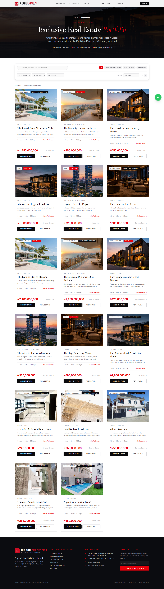

#### Current Text Inventory
* **Banner Category:** `EXCLUSIVE ACQUISITIONS PORTFOLIO`
* **Banner Headline:** `Curated Residences of Distinction`
* **Banner Subtitle:** `Discover unencumbered Governor's Consent and C-of-O titled private waterfront villas, smart contemporary terraces, and sky penthouses across Banana Island, Ikoyi, Eko Atlantic, and Abuja.`
* **Filters:** `All Residences`, `Waterfront Penthouses`, `Smart Terraces`, `Luxury Villas`

#### Client Change Request Table
| Section / Element | Current Text | Proposed Client Revised Text | Status |
| :--- | :--- | :--- | :--- |
| Portfolio Heading | Curated Residences of Distinction | | Pending |
| Filter Categories | All Residences / Waterfront Penthouses / Smart Terraces / Luxury Villas | | Pending |
| Pricing Labels | ₦1,250,000,000 / Ready for Handover / Off-Plan | | Pending |

---

### 1.3 Property Detail Dossier (`/properties/azure`)
* **URL:** `http://localhost:4200/properties/azure`
* **Route Title:** `Residence Dossier — Nigson Properties Limited`

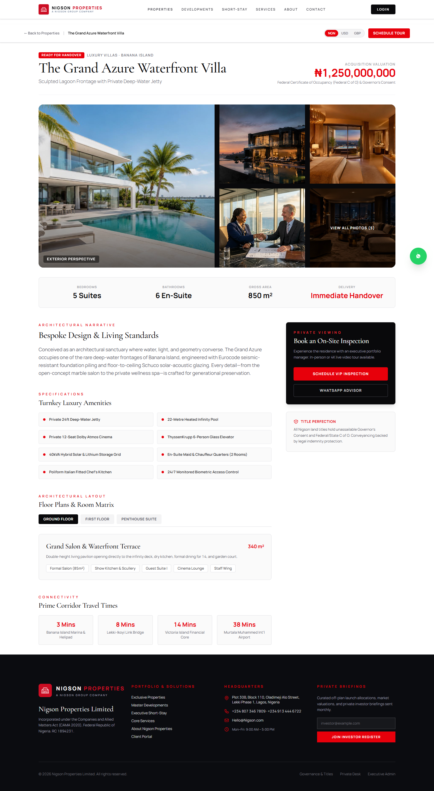

#### Current Text Inventory
* **Property Title:** `The Grand Azure Waterfront Villa`
* **Location & Address:** `Zone A, Ocean Parade Way, Banana Island, Ikoyi, Lagos`
* **Specs:** `5 Beds · 5.5 Baths · 850 sqm · ₦1,250,000,000`
* **Title Deed:** `Federal C-of-O & Lagos State Governor's Consent Verified`
* **Summary Copy:** `An ultra-luxury waterfront estate featuring private deep-water jetty, infinity edge pool overlooking Lagos lagoon, cinema room, and integrated Schneider smart home ecosystem.`

#### Client Change Request Table
| Section / Element | Current Text | Proposed Client Revised Text | Status |
| :--- | :--- | :--- | :--- |
| Title & Tagline | The Grand Azure Waterfront Villa | | Pending |
| Description / Amenities | Deep-water jetty, infinity pool, Schneider smart home... | | Pending |
| Title Deed Disclaimer | Federal C-of-O & Lagos State Governor's Consent Verified | | Pending |

---

### 1.4 Master Developments Matrix (`/projects`)
* **URL:** `http://localhost:4200/projects`
* **Route Title:** `Master Developments Matrix — Nigson Properties Limited`

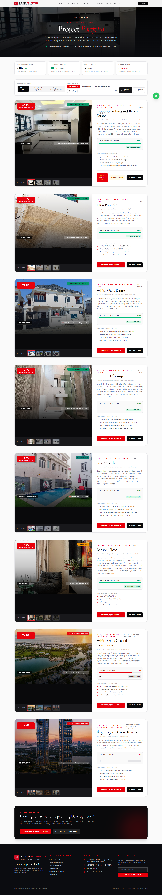

#### Current Text Inventory
* **Section Tag:** `MASTER-PLANNED DEVELOPMENTS & CONSTRUCTION`
* **Headline:** `Engineering Tomorrow's Iconic Landmarks`
* **Description:** `Track structural progress, bored piling, and capital allocation across our landmark residential estates in Lekki, Ikoyi, and Abuja.`
* **Key Projects Listed:** `Opposite Whitesand Beach Estate`, `Fatai Bankole Residences`, `White Oaks Estate`, `Olufemi Olatunji Residences`, `Nigson Villa Banana Island`.

#### Client Change Request Table
| Section / Element | Current Text | Proposed Client Revised Text | Status |
| :--- | :--- | :--- | :--- |
| Main Headline | Engineering Tomorrow's Iconic Landmarks | | Pending |
| Status Badges | Completed & Sold Out / Under Construction | | Pending |
| ROI Callouts | 32% Projected ROI / 100% Construction Completion | | Pending |

---

### 1.5 Development Project Dossier (`/projects/opposite-whitesand`)
* **URL:** `http://localhost:4200/projects/opposite-whitesand`
* **Route Title:** `Development Project Dossier — Nigson Properties Limited`

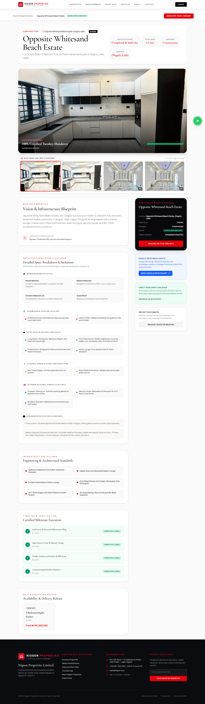

#### Current Text Inventory
* **Project Name:** `Opposite Whitesand Beach Estate`
* **Tagline:** `Luxurious Modern 5-Bedroom Fully and Semi-Detached Duplex in Ologolo, Lekki, Lagos`
* **Milestone Progress:** `100% Construction Complete · Handed Over to Investors`
* **Engineering Specs:** `Structural Grade C35 Concrete, German Hansgrohe Sanity fittings, Inverter & Solar Grid.`

#### Client Change Request Table
| Section / Element | Current Text | Proposed Client Revised Text | Status |
| :--- | :--- | :--- | :--- |
| Project Heading | Opposite Whitesand Beach Estate | | Pending |
| Construction Details | 100% Construction Complete / Sold Out | | Pending |

---

### 1.6 Executive Short-Stay Suites Hub (`/short-stay`)
* **URL:** `http://localhost:4200/short-stay`
* **Route Title:** `Executive Short-Stay Suites — Nigson Properties Limited`

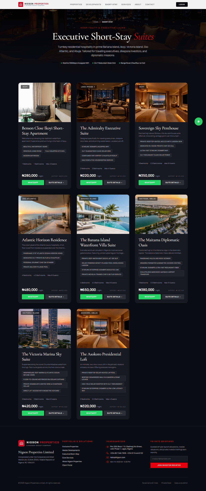

#### Current Text Inventory
* **Section Tag:** `HOSPITALITY & CONCIERGE RESIDENCES`
* **Headline:** `Ultra-Luxury Serviced Executive Short-Lets`
* **Subheading:** `Impeccably furnished 1 to 4 bedroom waterfront residences and penthouses in Ikoyi, Lekki Phase 1, Eko Atlantic, and Banana Island for corporate executives and discerning travelers.`
* **Nightly Rates Shown:** `₦220,000/night to ₦650,000/night` with 24/7 Chef, High-speed Starlink WiFi, and Security Chauffeur.

#### Client Change Request Table
| Section / Element | Current Text | Proposed Client Revised Text | Status |
| :--- | :--- | :--- | :--- |
| Section Header | Ultra-Luxury Serviced Executive Short-Lets | | Pending |
| Included Services | 24/7 Power, Starlink Internet, Private Concierge | | Pending |

---

### 1.7 Short-Stay Suite Detail (`/short-stay/benson-close-suite`)
* **URL:** `http://localhost:4200/short-stay/benson-close-suite`
* **Route Title:** `Serviced Suite Reservation — Nigson Properties Limited`

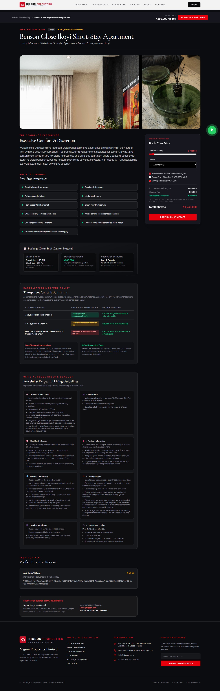

#### Current Text Inventory
* **Suite Title:** `Benson Close Ikoyi Short-Stay Apartment`
* **Location:** `Benson Close, Awolowo, Old Ikoyi, Lagos`
* **Rate:** `₦280,000 per night`
* **Capacity:** `1 Bedroom · 1.5 Baths · Max 2 Guests`
* **House Rules & Booking Form:** `Check-in 2:00 PM / Check-out 11:00 AM. Minimum 2 nights stay.`

#### Client Change Request Table
| Section / Element | Current Text | Proposed Client Revised Text | Status |
| :--- | :--- | :--- | :--- |
| Suite Description | Luxury 1-Bedroom Waterfront Short-let Apartment... | | Pending |
| Booking Terms | Check-in, Check-out, Caution Deposit Policy | | Pending |

---

### 1.8 Core Real Estate Services (`/services`)
* **URL:** `http://localhost:4200/services`
* **Route Title:** `Core Real Estate Services — Nigson Properties Limited`

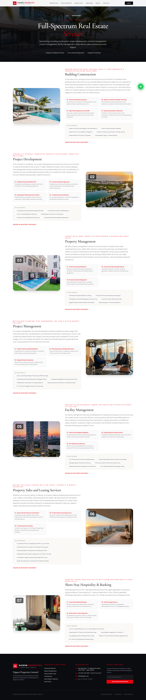

#### Current Text Inventory
* **Header Tag:** `COMPREHENSIVE ADVISORY & DEVELOPMENT SERVICES`
* **Headline:** `Bespoke Real Estate Services for High-Net-Worth Individuals & Institutional Investors`
* **Services Grid:**
  1. `Architectural Master-Planning & Turnkey Construction`
  2. `Private Client Real Estate Advisory & Acquisitions`
  3. `Title Regularization & Governor's Consent Due Diligence`
  4. `Luxury Asset Management & Executive Facility Care`
  5. `Hospitality & Short-Stay Facility Operations`
  6. `Diaspora Investment Syndication Desk`

#### Client Change Request Table
| Service Module | Current Title / Description | Proposed Client Revised Text | Status |
| :--- | :--- | :--- | :--- |
| Construction | Architectural Master-Planning & Turnkey Construction | | Pending |
| Advisory | Private Client Real Estate Advisory & Acquisitions | | Pending |
| Due Diligence | Title Regularization & Governor's Consent | | Pending |
| Diaspora Desk | Diaspora Investment Syndication Desk | | Pending |

---

### 1.9 Corporate Pedigree & Heritage (`/about`)
* **URL:** `http://localhost:4200/about`
* **Route Title:** `Corporate Pedigree & Leadership — Nigson Properties Limited`

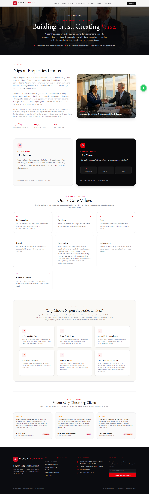

#### Current Text Inventory
* **Section Tag:** `OUR PEDIGREE & HERITAGE`
* **Headline:** `Pioneering Architectural Integrity & Unassailable Title Ownership`
* **Mission & Vision:** `Transforming prime African skylines through uncompromising engineering excellence, transparent corporate governance, and zero legal ambiguity.`
* **Corporate Details:** `CAMA RC 1894231 · Plot 30B, Block 110, Oladimeji Alo Street, Lekki Phase 1, Lagos`

#### Client Change Request Table
| Section / Element | Current Text | Proposed Client Revised Text | Status |
| :--- | :--- | :--- | :--- |
| Mission Statement | Transforming prime African skylines through... | | Pending |
| Registration Details | RC 1894231 & Corporate Disclosures | | Pending |

---

### 1.10 Corporate Headquarters & VIP Desk (`/contact`)
* **URL:** `http://localhost:4200/contact`
* **Route Title:** `Corporate Headquarters & VIP Desk — Nigson Properties Limited`

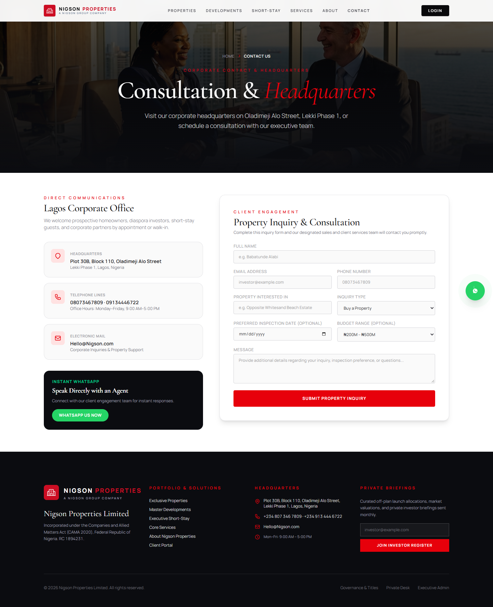

#### Current Text Inventory
* **Section Tag:** `CONNECT WITH OUR EXECUTIVES`
* **Headline:** `Private Consultations & Confidential Inquiries`
* **Contact Information:**
  * **Headquarters:** `Plot 30B, Block 110, Oladimeji Alo Street, Lekki Phase 1, Lagos`
  * **Direct Phones:** `+234 807 346 7809 / +234 913 444 6722`
  * **Email:** `Hello@Nigson.com`
  * **Office Hours:** `Monday–Friday, 9:00 AM–5:00 PM (WAT)`

#### Client Change Request Table
| Field / Label | Current Information | Proposed Client Revised Text | Status |
| :--- | :--- | :--- | :--- |
| Office Address | Plot 30B, Block 110, Oladimeji Alo Street, Lekki Phase 1 | | Pending |
| Contact Numbers | 08073467809 / 09134446722 | | Pending |
| Inquiry Form Fields | Name, Corporate Email, Investment Scope, Date | | Pending |

---

# 2. Authentication & Client Portal

### 2.1 Client Portal Login (`/login`)
* **URL:** `http://localhost:4200/login`
* **Route Title:** `Private Client Portal Authentication — Nigson Properties Limited`

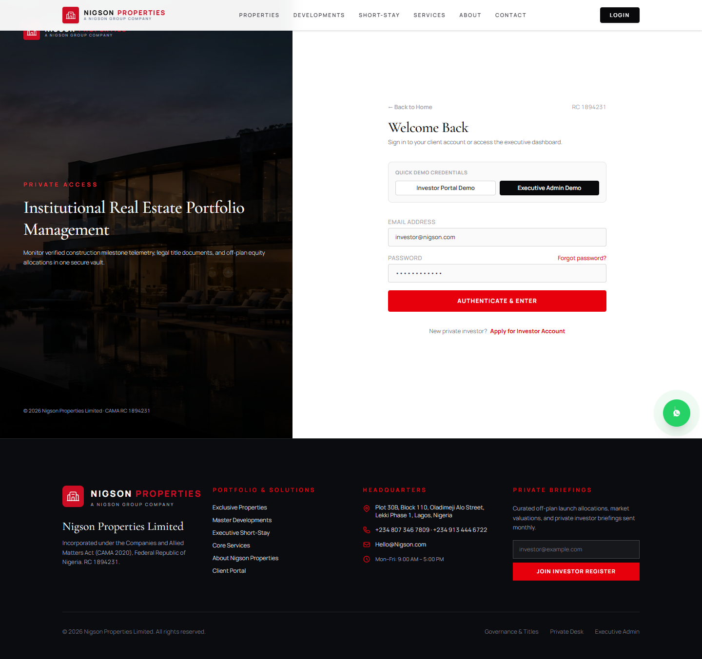

#### Current Text Inventory
* **Title:** `Sign In to Your Private Client Vault`
* **Subtitle:** `Access allocation documents, construction live cameras, payment milestones, and deed registries.`
* **Inputs:** `Email Address`, `Password`, `Remember this workstation`
* **Links:** `Forgot Password?`, `Apply for Investor Onboarding`

---

### 2.2 Investor Onboarding / Sign Up (`/signup`)
* **URL:** `http://localhost:4200/signup`
* **Route Title:** `Investor Onboarding — Nigson Properties Limited`

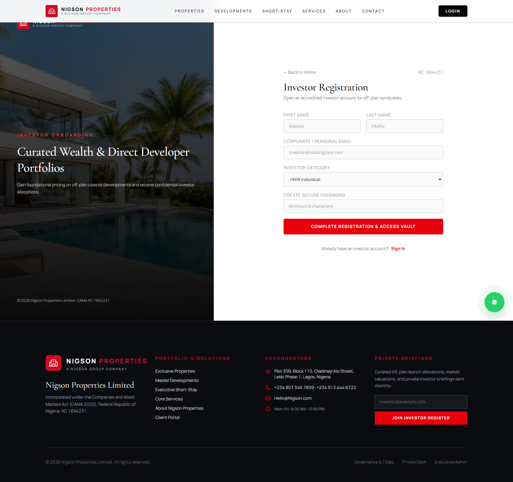

#### Current Text Inventory
* **Title:** `Private Investor Onboarding Registration`
* **Subtitle:** `Join our syndicate of discerning local and diaspora investors receiving exclusive off-market allocations and pre-launch pricing.`
* **Fields:** `Full Legal Name`, `Email Address`, `Phone Number (WhatsApp)`, `Country of Residence`, `Target Investment Scope`, `Password`

---

### 2.3 Password Reset (`/forgot-password`)
* **URL:** `http://localhost:4200/forgot-password`
* **Route Title:** `Reset Password — Nigson Properties Limited`

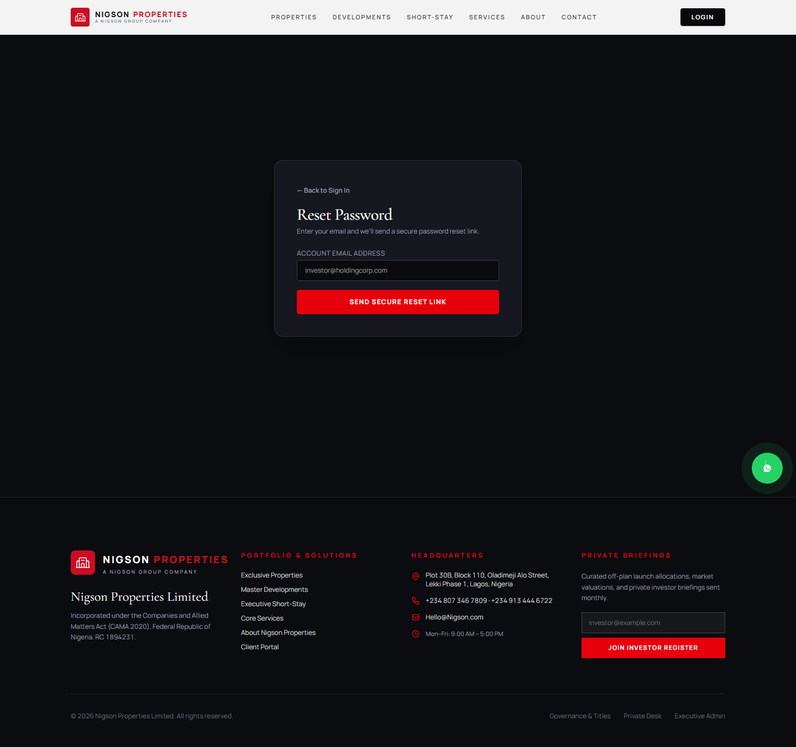

#### Current Text Inventory
* **Title:** `Reset Your Vault Password`
* **Instruction:** `Enter your verified corporate or investor email to receive single-use authentication credentials.`

---

### 2.4 Client Portal Vault (`/portal`)
* **URL:** `http://localhost:4200/portal`
* **Route Title:** `Client Portal Vault — Nigson Properties Limited`

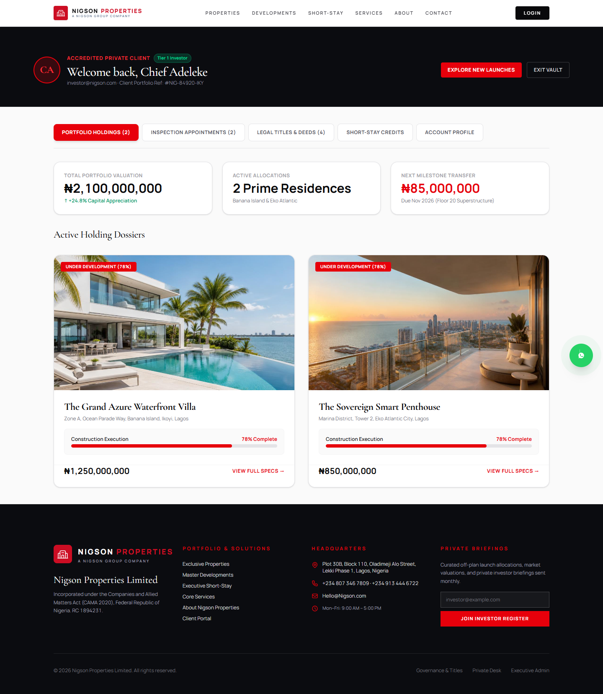

#### Current Text Inventory
* **Header:** `Investor Asset Vault & Telemetry`
* **Tabs:** `Active Allocations`, `Payment Receipts & Deeds`, `Live Construction Feeds`, `Concierge Requests`

---

# 3. Executive Admin CRM Console (`/admin`)

### 3.1 Executive Overview Module
* **URL:** `http://localhost:4200/admin` (Module: `overview`)
* **Console Category:** `TELEMETRY & PERFORMANCE`

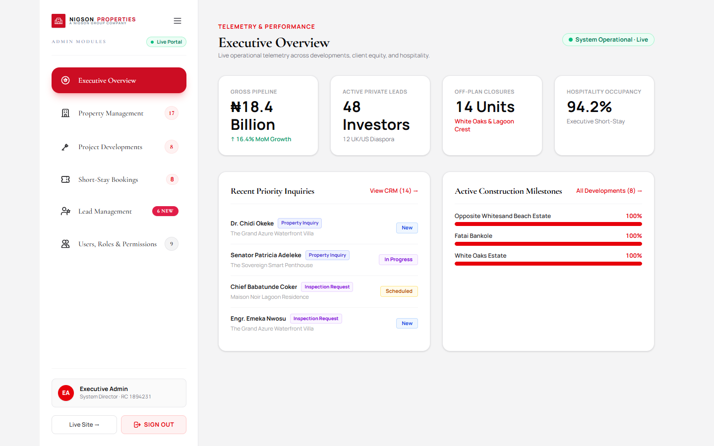

#### Current Telemetry KPI Cards
1. **Gross Pipeline:** `₦18.4 Billion` (↑ 16.4% MoM Growth)
2. **Active Private Leads:** `48 Investors` (12 UK/US Diaspora)
3. **Off-Plan Closures:** `14 Units` (White Oaks & Lagoon Crest)
4. **Hospitality Occupancy:** `94.2%` (Executive Short-Stay)
5. **Recent Priority Inquiries:** Quick list with Dr. Chidi Okeke, Senator Patricia Adeleke, Chief Babatunde Coker, Engr. Emeka Nwosu.

#### Client Change Request Table
| Widget / Metric | Current Metric / Label | Proposed Client Adjustment | Status |
| :--- | :--- | :--- | :--- |
| Gross Pipeline KPI | ₦18.4 Billion / 16.4% MoM Growth | | Pending |
| Target Occupancy KPI | 94.2% Executive Short-Stay | | Pending |

---

### 3.2 Property Management CMS
* **URL:** `http://localhost:4200/admin` (Module: `properties`)
* **Console Category:** `INVENTORY CMS`

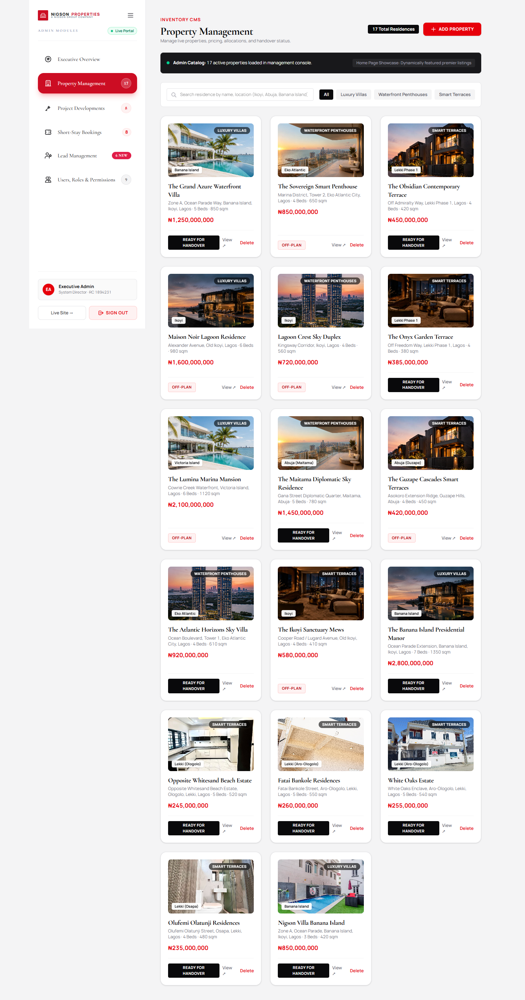

#### Current Text & Listings Inventory
* **Header Tag:** `INVENTORY CMS`
* **Headline:** `Property Management`
* **Subheading:** `Manage live properties, pricing, allocations, and handover status.`
* **Count:** `17 Total Residences`
* **Filter Badges:** `All`, `Luxury Villas`, `Waterfront Penthouses`, `Smart Terraces`
* **Key Listing Cards Rendered:**
  * `The Grand Azure Waterfront Villa` — ₦1,250,000,000 (Banana Island)
  * `The Sovereign Smart Penthouse` — ₦850,000,000 (Eko Atlantic)
  * `The Obsidian Contemporary Terrace` — ₦450,000,000 (Lekki Phase 1)
  * `Maison Noir Lagoon Residence` — ₦1,600,000,000 (Ikoyi)
  * `Lagoon Crest Sky Duplex` — ₦720,000,000 (Ikoyi)
  * `The Onyx Garden Terrace` — ₦385,000,000 (Lekki Phase 1)
  * `The Lumina Marina Mansion` — ₦2,100,000,000 (Victoria Island)
  * `The Maitama Diplomatic Sky Residence` — ₦1,450,000,000 (Maitama, Abuja)
  * `The Guzape Cascades Smart Terraces` — ₦420,000,000 (Guzape, Abuja)

#### Client Change Request Table
| Listing / Field | Current Text / Price | Proposed Client Revision | Status |
| :--- | :--- | :--- | :--- |
| Category Filters | Luxury Villas / Waterfront Penthouses / Smart Terraces | | Pending |
| Action Buttons | View / Delete / + Add Property | | Pending |

---

### 3.3 Masterplan Projects & Developments
* **URL:** `http://localhost:4200/admin` (Module: `projects`)
* **Console Category:** `MASTERPLAN TELEMETRY`

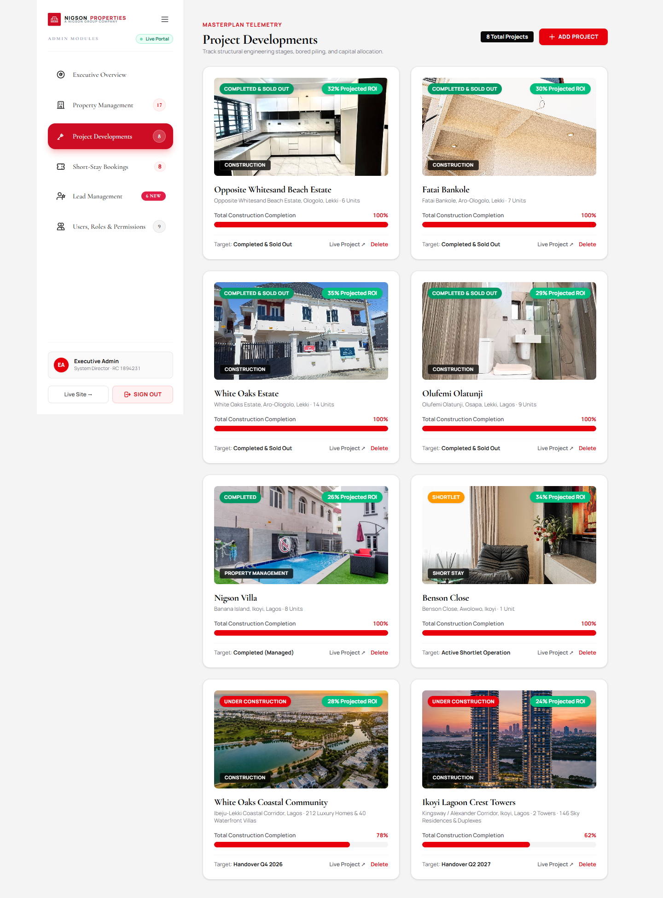

#### Current Text & Milestone Inventory
* **Headline:** `Project Developments`
* **Subheading:** `Track structural engineering stages, bored piling, and capital allocation.`
* **Count:** `8 Total Projects`
* **Active Developments Tracked:**
  * `Opposite Whitesand Beach Estate` — 100% Completion (32% Projected ROI)
  * `Fatai Bankole` — 100% Completion (30% Projected ROI)
  * `White Oaks Estate` — 100% Completion (35% Projected ROI)
  * `Olufemi Olatunji` — 100% Completion (29% Projected ROI)
  * `Nigson Villa` — 100% Completion (26% Projected ROI)
  * `Benson Close` — 100% Completion (34% Projected ROI)
  * `White Oaks Coastal Community` — 78% Completion (Handover Q4 2026)
  * `Ikoyi Lagoon Crest Towers` — 62% Completion (Handover Q2 2027)

#### Client Change Request Table
| Development Name | Current Completion % & ROI | Proposed Client Revision | Status |
| :--- | :--- | :--- | :--- |
| Opposite Whitesand | 100% Completion / 32% ROI | | Pending |
| White Oaks Coastal | 78% Completion / Handover Q4 2026 | | Pending |
| Ikoyi Lagoon Crest | 62% Completion / Handover Q2 2027 | | Pending |

---

### 3.4 Hospitality & Short-Stay Bookings
* **URL:** `http://localhost:4200/admin` (Module: `shortstay`)
* **Console Category:** `HOSPITALITY & CONCIERGE`

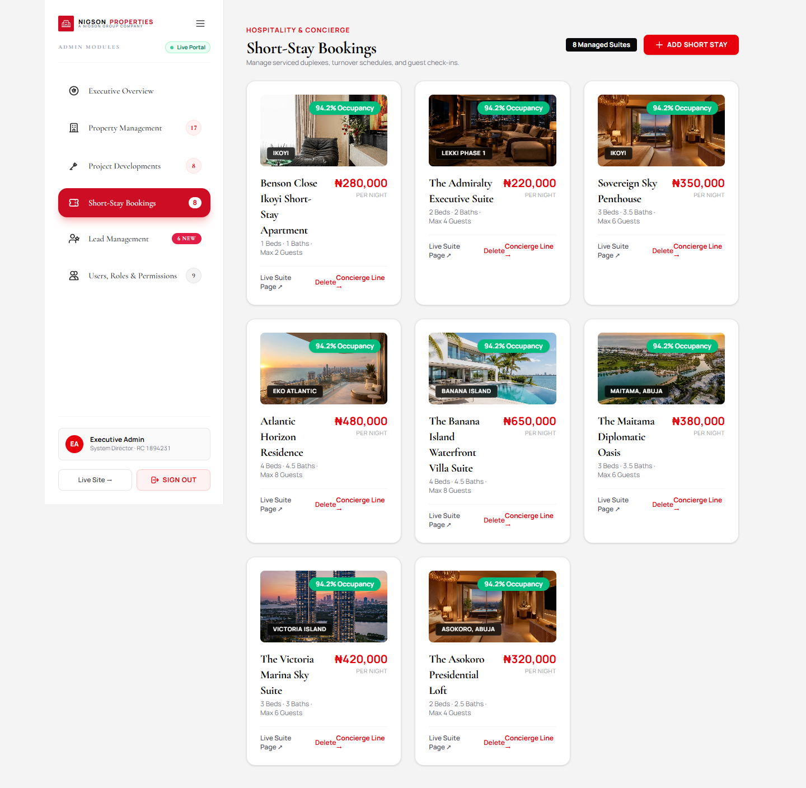

#### Current Suites & Tariff Breakdown
* **Headline:** `Short-Stay Bookings`
* **Count:** `8 Managed Suites`
* **Suites Active:**
  1. `Benson Close Ikoyi Short-Stay Apartment` — ₦280,000 / night (Ikoyi)
  2. `The Admiralty Executive Suite` — ₦220,000 / night (Lekki Phase 1)
  3. `Sovereign Sky Penthouse` — ₦350,000 / night (Ikoyi)
  4. `Atlantic Horizon Residence` — ₦480,000 / night (Eko Atlantic)
  5. `The Banana Island Waterfront Villa Suite` — ₦650,000 / night (Banana Island)
  6. `The Maitama Diplomatic Oasis` — ₦380,000 / night (Maitama, Abuja)
  7. `The Victoria Marina Sky Suite` — ₦420,000 / night (Victoria Island)
  8. `The Asokoro Presidential Loft` — ₦320,000 / night (Asokoro, Abuja)

#### Client Change Request Table
| Suite Name | Current Nightly Rate | Proposed Nightly Rate / Copy | Status |
| :--- | :--- | :--- | :--- |
| Benson Close | ₦280,000 / night | | Pending |
| Admiralty Suite | ₦220,000 / night | | Pending |
| Banana Island Villa | ₦650,000 / night | | Pending |

---

### 3.5 VIP Leads CRM & Inquiries
* **URL:** `http://localhost:4200/admin` (Module: `leads`)
* **Console Category:** `EXECUTIVE VIP CRM`

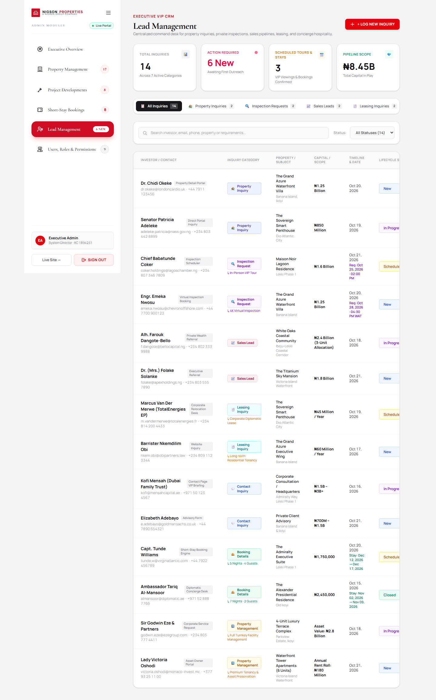

#### Current Leads & Pipeline Metrics
* **Total Inquiries:** `14 Inquiries Across 7 Active Categories`
* **Action Required:** `6 New (Awaiting First Outreach)`
* **Scheduled Tours:** `3 VIP Viewings Confirmed`
* **Pipeline Scope:** `₦8.45B Total Capital In Play`
* **Categories:** `Property Inquiry`, `Inspection Request`, `Sales Lead`, `Leasing Inquiry`, `Contact Inquiry`, `Booking Details`, `Property Management`

#### Client Change Request Table
| CRM Element | Current Setting / Label | Proposed Client Revision | Status |
| :--- | :--- | :--- | :--- |
| Categories | Property Inquiry / Inspection / Sales Lead / Leasing... | | Pending |
| Status Labels | New / In Progress / Scheduled / Closed | | Pending |

---

### 3.6 Enterprise Access, Users & Permissions
* **URL:** `http://localhost:4200/admin` (Module: `users`)
* **Console Category:** `ENTERPRISE ACCESS & GOVERNANCE`

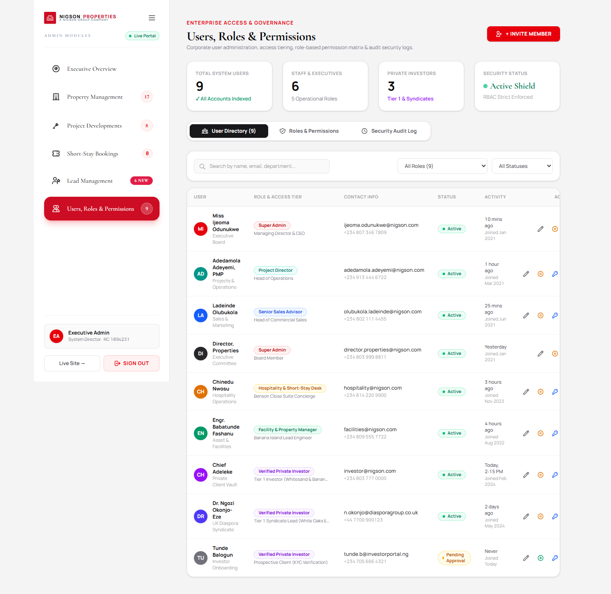

#### Current User Directory & Roles
* **Total System Users:** `9 Users Across 5 Operational Roles`
* **Staff & Executives:** `6` | **Private Investors:** `3`
* **Security Status:** `Active Shield — RBAC Strict Enforced`
* **Key Executive Profiles:**
  * `Miss Ijeoma Odunukwe` — Super Admin (Managing Director & CEO)
  * `Adedamola Adeyemi, PMP` — Project Director (Head of Operations)
  * `Ladeinde Olubukola` — Senior Sales Advisor (Head of Commercial Sales)
  * `Director, Properties` — Super Admin (Board Member)
  * `Chinedu Nwosu` — Hospitality & Short-Stay Desk (Concierge Lead)
  * `Engr. Babatunde Fashanu` — Facility & Property Manager (Lead Engineer)
  * `Chief Adeleke` — Verified Private Investor
  * `Dr. Ngozi Okonjo-Eze` — Verified Private Investor (UK Diaspora Lead)
  * `Tunde Balogun` — Verified Private Investor (Pending KYC)

#### Client Change Request Table
| User / Role Profile | Current Title & Department | Proposed Client Revision | Status |
| :--- | :--- | :--- | :--- |
| Managing Director & CEO | Miss Ijeoma Odunukwe | | Pending |
| Head of Operations | Adedamola Adeyemi, PMP | | Pending |
| Head of Commercial Sales | Ladeinde Olubukola | | Pending |
| Role Tiers | Super Admin / Project Director / Sales Advisor / Facility / Investor | | Pending |

---

## Next Steps for the Client

1. Review each screenshot and corresponding text block above.
2. In the **Proposed Client Revised Text** column of each table, enter your updated copy, price corrections, address adjustments, or executive title changes.
3. Once completed, share the marked document back so the content changes can be applied directly to the codebase.
